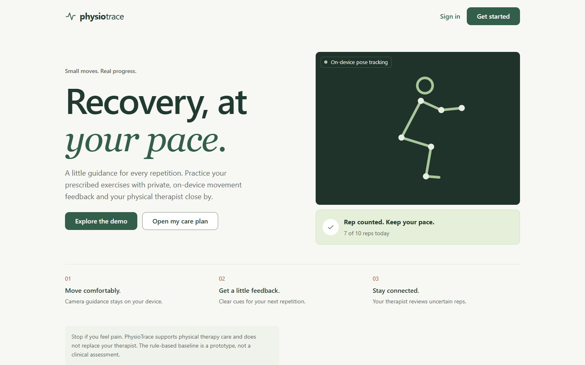
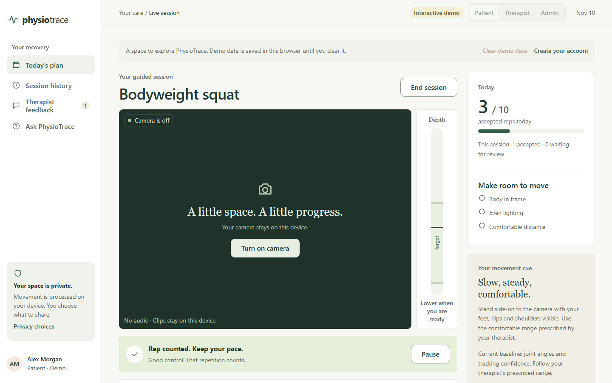
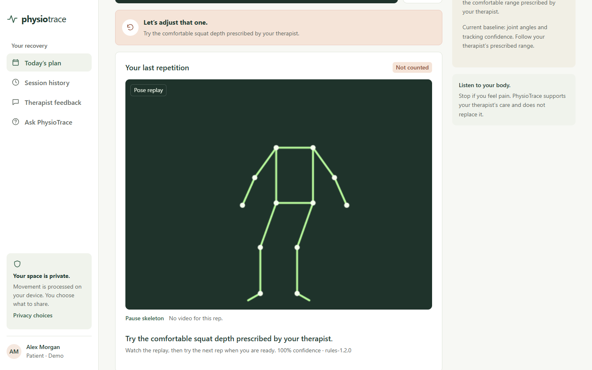
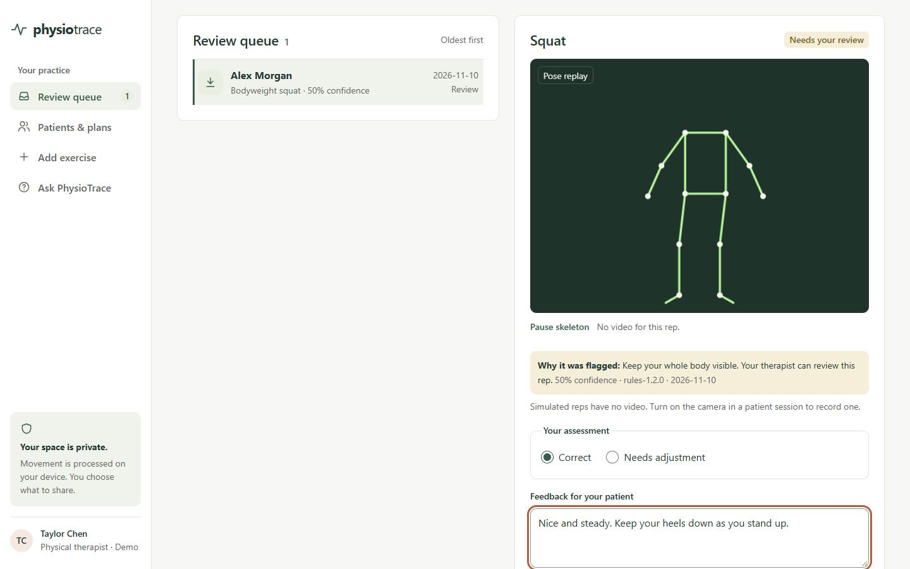
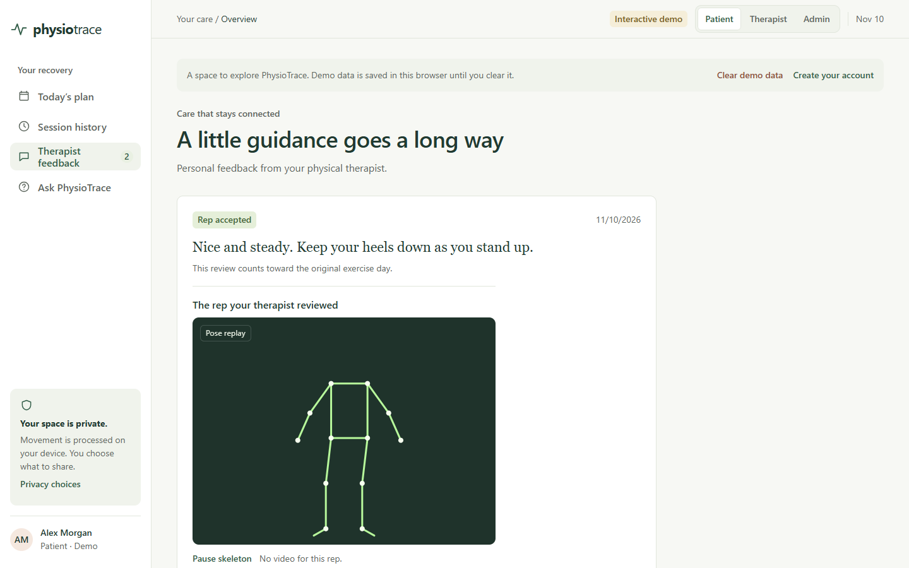
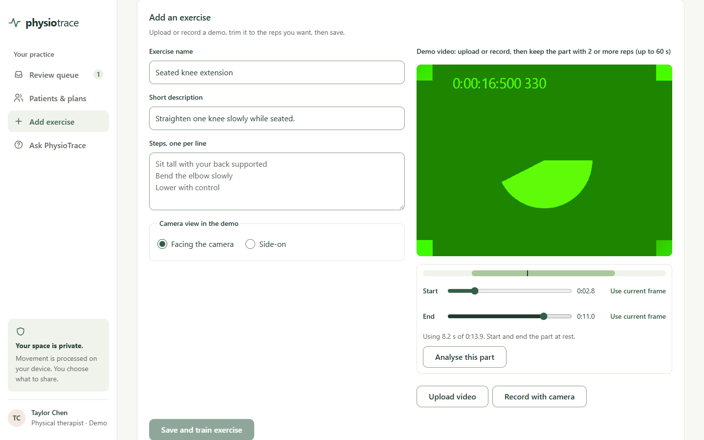
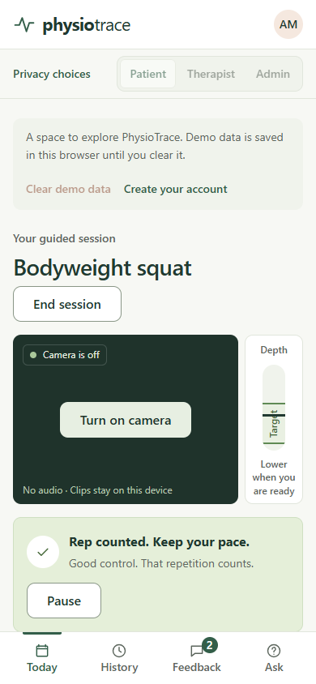
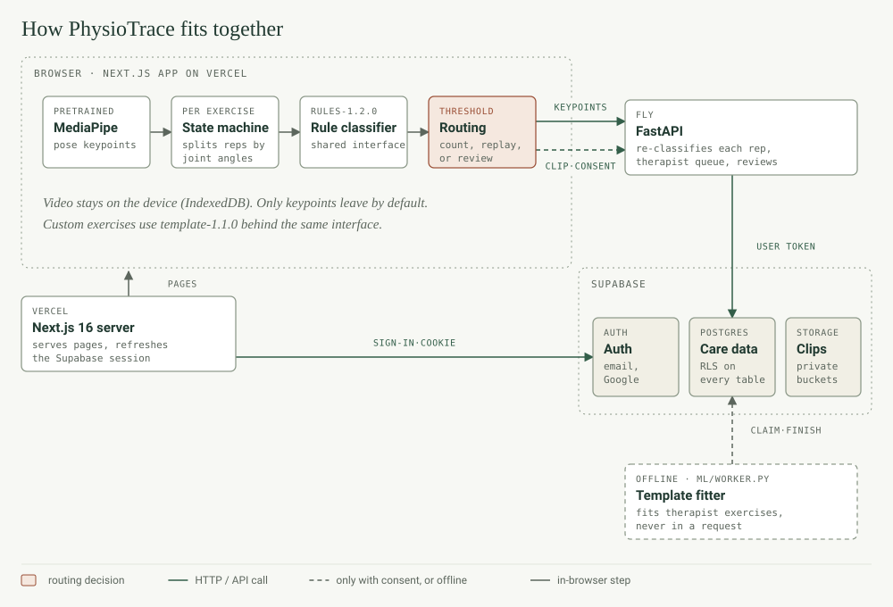
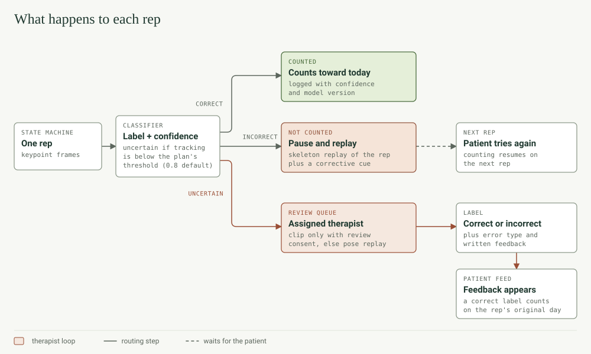
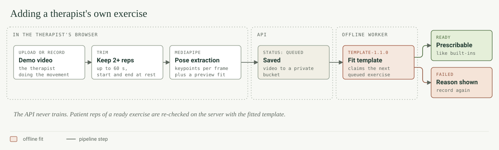

# PhysioTrace

PhysioTrace watches a patient do their prescribed physio exercises through the browser camera, checks each rep, and sends the unclear ones to their physical therapist.

<!-- AWARD PHOTO: docs/images/award.jpg (added later) -->

🥈 2nd place overall and winner of the [Entire](https://entire.com/about/company) category at Hack the Change 2026.

## What it is

Dave does his squats in the living room. PhysioTrace counts the good reps, replays the ones that need adjusting, and sends the unclear ones to his therapist. Pose tracking runs in the browser with MediaPipe, and the video stays on his device. A versioned rule classifier (`rules-1.2.0`) judges each rep from joint angles and tracking confidence. Therapists review uncertain reps, label them, send written feedback, and can add their own exercises from a demo video. A template fitter (`template-1.1.0`) learns those from the video. No neural network has been trained. MediaPipe's pose model is the only pretrained model in the project.

Try it without an account at `/demo` once it's running locally (see [Run it locally](#run-it-locally)).

## Screenshots

|                                                                                         |                                                                                      |
| --------------------------------------------------------------------------------------- | ------------------------------------------------------------------------------------ |
|                                                 |           |
| Landing page                                                                            | Live session with the depth gauge and its target band                                |
|  |                           |
| An incorrect rep, replayed with a skeleton and a cue                                    | Therapist review queue with the flagged rep                                          |
|                               |  |
| Therapist feedback in the patient's feed                                                | Adding an exercise and trimming its demo video                                       |

<p align="center"></p>

The screenshots come from the demo's simulated reps. The trim screen shows the browser's fake test camera, not a person.

## How it works



1. MediaPipe Pose Landmarker turns each camera frame into body keypoints in the browser.
2. A state machine for each exercise splits the keypoint stream into reps using joint-angle thresholds.
3. The classifier returns `correct`, `incorrect`, or `inconclusive` with a confidence score. The API runs the same rules again on the keypoints before it saves a rep.
4. The rep is routed by that label and the confidence threshold on the patient's plan:



Therapists can also add their own exercises. The worker in `ml/worker.py` runs outside the API, so no training ever happens inside a request:



## Design choices

- The classifiers only see pose keypoint sequences. Camera frames are never sent anywhere for classification.
- Video stays on the device. Each rep's clip is kept in the browser's IndexedDB for the patient's own history, and a clip is uploaded only when the rep is uncertain and the patient has turned on review consent. Training consent is a separate setting. It's off by default and doesn't start any training.
- The rule baseline and the template model implement the same `RepClassifier` contract (`frontend/src/features/physio/engine.ts`, mirrored in `backend/app/physio.py`), so a trained model can replace them later without changes elsewhere.
- Every care table in Postgres has row-level security. A therapist sees only the patients assigned to them, and admins manage accounts without access to clinical records.
- The interface is built for patients in their 60s and older: body text is at least 16px, buttons are 44px tall, and each screen has one obvious next step. We checked all 20 text and background pairs in the palette (`frontend/src/app/globals.css`) with a contrast script, and every one passes WCAG AA. The lowest is 4.98:1. Input borders and the focus ring pass 3:1.
- The app tells patients to stop if they feel pain and says it supports a therapist's care. The rule ranges are prototype values that still need clinical validation.

## Why it matters

Patients do their home exercises between appointments with nobody checking their form, and in Alberta those gaps can be long. In 2023, the median wait from a GP referral to treatment by a specialist was 33.5 weeks in Alberta, against 27.7 weeks across Canada ([Fraser Institute, _Waiting Your Turn: Wait Times for Health Care in Canada, 2023_](https://www.fraserinstitute.org/sites/default/files/waiting-your-turn-2023.pdf)). That figure covers specialist care in general, not physiotherapy alone. PhysioTrace lets a therapist see home practice between visits, and they only review the reps the rules can't judge.

## Run it locally

You need Node.js 24 and [uv](https://docs.astral.sh/uv/). Supabase is optional, because the landing page and `/demo` work with blank keys.

macOS or Linux:

```bash
cp -n .env.example .env
./scripts/dev.sh
```

Windows (PowerShell): install the frontend once, then run the API and the web app in two terminals.

```powershell
npm ci --prefix frontend
```

```powershell
.\scripts\backend.ps1
```

```powershell
.\scripts\frontend.ps1
```

Then open <http://127.0.0.1:3000/demo>. The demo stores its data in your browser until you press Clear demo data, and it uploads nothing.

Connecting Supabase, Google sign-in, admins, the exercise trainer, the AI assistant, and the optional CUDA/MLX setup are covered in [docs/setup.md](docs/setup.md). Production deployment is in [docs/deployment.md](docs/deployment.md).

## Tests

```bash
cd frontend && npm run typecheck && npm test && npm run build
cd backend && uv run pytest
```

The frontend tests use Node's built-in runner and cover the exercise state machines, confidence routing, the template fitter, trimming, and setup prompts. The backend tests cover auth, role checks, rep submission, reviews, custom exercises, admin routes, and the template fitter. The TypeScript and Python template fitters are checked against the same fixtures in `ml/fixtures/`. The row-level security checks run against a throwaway PGlite database ([docs/verification.md](docs/verification.md#run-the-database-checks)). CI runs all of the commands above on every push and pull request ([.github/workflows/ci.yml](.github/workflows/ci.yml)).

## Project layout

```text
.
├── frontend/             Next.js 16 app (Vercel)
│   ├── src/app/          thin route pages: /, /demo, /dashboard, /login, /signup
│   ├── src/features/     physio (patient + therapist UI, engine), auth, ai, ui
│   ├── src/lib/          Supabase clients and API helper
│   └── scripts/          prepare-pose.mjs (MediaPipe assets)
├── backend/              FastAPI app (Fly)
│   ├── app/              routers, auth, rule classifier, template classifier
│   ├── supabase/         migrations, RLS, admin SQL
│   └── tests/            pytest
├── ml/                   offline template fitter, worker, shared fixtures
├── scripts/              dev, worker, push-env, worktree helpers
├── docs/                 setup, deployment, architecture, decisions, diagrams, images
├── AGENTS.md             project brief for coding agents (CLAUDE.md points here)
└── CONTRIBUTING.md       coding standards
```

## Roadmap

- Train a classifier on public rehab datasets with correct and incorrect labels (UI-PRMD, KIMORE, after checking their licenses), plus therapist-labelled clips from patients who gave training consent. It would plug in behind the same classifier interface.
- A standard exercise library beyond the bodyweight squat and standing shoulder abduction.
- A pilot with a physiotherapy clinic in Calgary.

## Team

- Ahron Ramos
- Ben Bui
- Ethan De La Cruz
- Yiming (Harry) Jin

## License

This project is licensed under the MIT License. See the LICENSE file for details.
